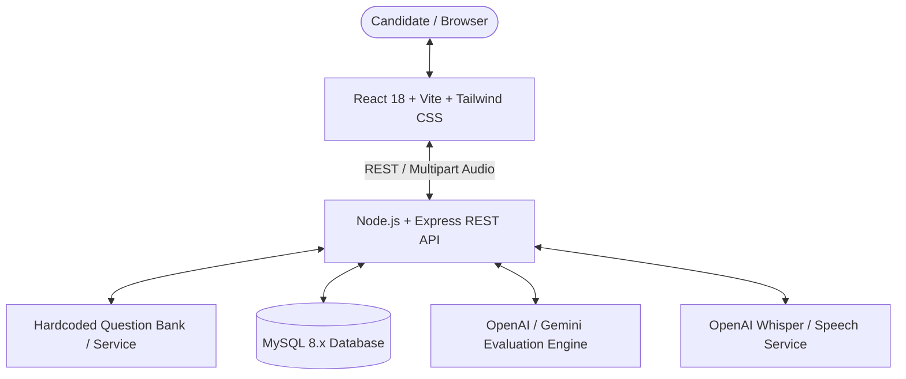

# InterviewIQ AI — Master Architecture & Technical Specification

## 1. System Overview
**InterviewIQ AI** is an AI-powered interactive mock interview platform designed for final-year MCA capstone demonstration and professional portfolios. It features real-time text and speech answering, multi-provider evaluation (OpenAI & Gemini), dimensional rubric scoring, and persistent performance analytics.



## 2. Directory Structure
```
interviewiq-ai/
  ├── frontend/                     # React 18 + Vite + Tailwind CSS
  │   ├── src/
  │   │   ├── components/           # Navbar, Cards, Inputs, Modals
  │   │   ├── pages/                # Landing, Setup, Room, Report, Dashboard, History
  │   │   ├── services/             # Axios API client
  │   │   ├── App.jsx               # React Router configuration
  │   │   └── main.jsx
  │   ├── package.json
  │   └── vite.config.js
  ├── backend/                      # Node.js + Express (ES Modules)
  │   ├── src/
  │   │   ├── config/               # DB and environment configuration
  │   │   ├── data/
  │   │   │   └── questionBank.js   # Decoupled hardcoded question bank
  │   │   ├── services/             # QuestionBankService, AI providers, Speech
  │   │   ├── routes/               # API routes
  │   │   ├── controllers/          # Request controllers
  │   │   ├── middleware/           # Auth, error handling, rate limiting
  │   │   ├── app.js                # Express app setup
  │   │   └── server.js             # HTTP server entrypoint
  │   ├── tests/                    # Automated test suites
  │   ├── package.json
  │   └── .env.example
  ├── database/                     # MySQL scripts & schema
  │   └── schema.sql
  ├── docs/                         # Architecture, API, & Testing specs
  └── PROJECT_PROGRESS.md           # 5-Phase tracking document
```

## 3. Decoupled Question Bank Architecture
The question bank is maintained in [`backend/src/data/questionBank.js`](file:///Users/adarshkumar/Desktop/AI-Interview-Preparation/backend/src/data/questionBank.js) and mediated by [`backend/src/services/questionBankService.js`](file:///Users/adarshkumar/Desktop/AI-Interview-Preparation/backend/src/services/questionBankService.js). The service abstraction provides:
- Filtering by role, topic, and difficulty.
- Sanitization: expected answers and scoring rubrics are never leaked to the client before answer submission.
- Future-proof migration path: switching to a MySQL table or an automated question-generation pipeline requires changing only the service internals, leaving the frontend and controllers untouched.
